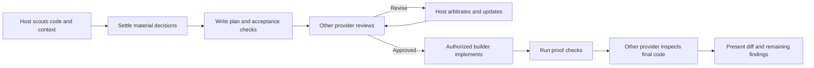

<div align="center">


### Agent workflow skills for Antigravity, Claude Code, and Codex.

[](https://github.com/chaseai-yt/claudex-loop/stargazers)
[](./LICENSE)
</div>

This repository contains separate skills for choosing a model, making a one-off handoff, and running a complete development workflow. The main Claudex Loop workflow uses Antigravity with a fixed Gemini/Claude role pairing. Standalone Claude Code/Codex compatibility commands remain available; **Claudex Route is independent of Claudex Loop**.

| Skill | Use it for | Dependencies |
|---|---|---|
| [`claudex-route`](skills/claudex-route/SKILL.md) | A model recommendation or one scoped handoff | Self-contained; selected CLI needed only for delegation |
| [`claudex-loop`](skills/claudex-loop/SKILL.md) | Antigravity planning, independent plan approval, and one-change-at-a-time implementation/review | Antigravity with the specified models |
| [`codex-review`](skills/codex-review/SKILL.md) | Legacy Claude Code/Codex CLI plan-review compatibility command | Shared CLI runner, Claude Code, and Codex |
| [`codex-build`](skills/codex-build/SKILL.md) | Legacy Claude Code/Codex CLI build compatibility command | Shared CLI runner, Claude Code, and Codex |

## Claudex Loop

Claudex Loop uses dedicated Antigravity roles. Gemini 4 Argon (high thinking) plans; a separate Claude Opus 5.5 (medium thinking) instance approves the plan; Gemini 3.8 Flash (high thinking) implements it. Each developer change is reviewed by a new Claude Opus 5.5 (medium thinking) instance before the next change begins.

| Stage | Antigravity role | Model | Thinking |
|---|---|---|---|
| Planning | Planner | Gemini 4 Argon | High |
| Plan review | Separate reviewer instance | Claude Opus 5.5 | Medium |
| Implementation | Developer | Gemini 3.8 Flash | High |
| Each change review | New reviewer instance for that change | Claude Opus 5.5 | Medium |

The plan must name every file and function to edit, specify the expected output/observable behavior of each function, and map each function to a covering test. The developer makes one independently reviewable change, runs its named test, then waits for a fresh Opus review before continuing. Corrections also require a new review instance. See the [complete Antigravity workflow contract](skills/claudex-loop/references/antigravity.md).

Use the required model and thinking mode at every stage. If Antigravity cannot select or verify one, stop and report the blocker; do not silently substitute another model, mode, provider, or CLI.

## Claudex Route: standalone task routing

Use [`claudex-route`](skills/claudex-route/SKILL.md) when you want help choosing who should handle a task. It recommends a model and a role with a short reason: stay with the current agent, get a second opinion on a plan or implementation, investigate a blocker, or delegate a bounded task. It can perform one handoff when requested. Recommendations alone do not launch another model or authorize edits.

```text
claudex-route: Who should handle this CSV import feature? Prioritize cost.
claudex-route: Recommend a second opinion on this plan before we build.
claudex-route: Pick a suitable model and have it diagnose this failing test read-only.
```

For example, Luna may suit a focused fixture-generation task, Sol a bounded implementation, and Astra or Fable a difficult review. These are task-fit recommendations, not a fixed ranking; available models, context, verification, and current pricing matter. Staying with your current model is a valid result. Route is a self-contained instruction skill with no Python dependency; a delegated run requires the selected CLI and account access. It does not use the full loop's approval-binding runner.

Claudex Route runs independently. Use **Claudex Loop** when you want repeated plan review, implementation, and independent inspection.

## The Claudex Loop workflow



1. **Recon:** inspect relevant code and tests. Inventory and use every agent and skill available in the developer environment, including workspace-local `.agent` content; record any invocation limitations.
2. **Plan:** Gemini 4 Argon writes acceptance criteria, assumptions, risks, proof commands, and a per-function table of files, functions, expected behavior, and covering tests.
3. **Plan approval:** a separate Claude Opus 5.5 instance reviews the exact plan. Only `APPROVED` permits implementation; a changed plan needs another review.
4. **Incremental implementation:** Gemini 3.8 Flash makes one planned change and runs its named test. A new Claude Opus 5.5 instance reviews that change. The developer waits for approval before making the next change. Revisions receive another fresh review.
5. **Final verification:** run full proof commands and inspect the complete diff after all changes pass their individual reviews.

The user controls consequential decisions and authorization. A request to review a plan does not authorize implementation. A request to plan and implement does not need redundant build approval. Commits, pushes and publication follow the user's existing instructions.

`PLAN.md` records what to build; `PLAN-REVIEW-LOG.md` records agent/skill inventory, findings, dispositions, model/mode selections, per-change tests and reviews, proof, and remaining uncertainty. Both paths are configurable.

## Install

Antigravity must provide the specified models and thinking modes for the full Claudex Loop workflow. The separate legacy CLI compatibility commands require Claude Code, Codex, and Python **3.10+**; they do not enforce the Antigravity workflow.

### Claude Code plugin

```text
/plugin marketplace add chaseai-yt/claudex-loop
/plugin install claudex-loop@claudex-loop
```

Use `/claudex-loop:claudex-route` for a lightweight recommendation or one-off handoff, or `/claudex-loop:claudex-loop`, `/claudex-loop:codex-review`, or `/claudex-loop:codex-build` for the existing workflows. Enable marketplace auto-update in the plugin menu if desired.

### Codex or manual skill installation

Clone this repository and copy the skill directories you need. The legacy compatibility commands share the CLI runtime inside `claudex-loop`; copying an alias alone is insufficient. `claudex-route` can also be installed on its own.

For Antigravity, install `skills/claudex-loop/` as a workspace skill under `.agent/skills/claudex-loop/` so its `SKILL.md` and `references/` are available to the planner and developer. Keep `.agent` instructions and available skills in scope for the planner's required inventory.

To install **only Claudex Route**, copy `skills/claudex-route/` into `~/.agents/skills/` for Codex or `~/.claude/skills/` for Claude Code. No other skill from this repository is required. The commands below install the complete collection into both hosts.

```bash
# macOS / Linux — run from this repository
mkdir -p ~/.agents/skills ~/.claude/skills
cp -R skills/. ~/.agents/skills/
cp -R skills/. ~/.claude/skills/
```

```bash
# Antigravity — run from the project workspace
mkdir -p .agent/skills/claudex-loop
cp -R /path/to/claudex-loop/skills/claudex-loop/. .agent/skills/claudex-loop/
```

```powershell
# Windows PowerShell — run from this repository
New-Item -ItemType Directory -Force "$env:USERPROFILE\.agents\skills", "$env:USERPROFILE\.claude\skills" | Out-Null
Copy-Item -Recurse -Force skills\* "$env:USERPROFILE\.agents\skills\"
Copy-Item -Recurse -Force skills\* "$env:USERPROFILE\.claude\skills\"
```

Open a new session to pick up the skills. In Antigravity, invoke the installed `claudex-loop` skill for the full workflow. In Codex, invoke `$claudex-route` or the explicit compatibility commands; in Claude Code, invoke `/claudex-route` or those compatibility commands. Updates are `git pull` and re-copy. A `.codex-plugin/plugin.json` is also supplied for Codex plugin packaging; manual skill installation does not require adding a marketplace.

### Examples

```text
claudex this feature in Antigravity — plan and implement it using the required roles
claudex this plan in Antigravity, plan=docs/migration.md
codex-review this existing plan with the legacy CLI workflow
codex-build this approved work order with the legacy CLI workflow
```

The first two examples use the main Antigravity workflow. The latter examples are separate Claude Code/Codex CLI compatibility workflows and do not provide the required per-change Antigravity reviews.

## Controls

| Argument | Default | Purpose |
|---|---|---|
| `mode` | `full` | `review` starts from an existing plan |
| `plan` / `PLAN_FILE` | `PLAN.md` | Plan path, carried through every phase |
| `log` / `LOG_FILE` | `PLAN-REVIEW-LOG.md` | Append-only decision log |
| Planner | Gemini 4 Argon, high | Fixed Antigravity role |
| Plan reviewer | Claude Opus 5.5, medium | Separate Antigravity instance |
| Developer | Gemini 3.8 Flash, high | Fixed Antigravity role |
| Change reviewer | Claude Opus 5.5, medium | Fresh Antigravity instance after each developer change |
| `inspect` | required | Per-change review cannot be disabled |
| `PROOF_CMD` | from plan/repo | Agreed command that verifies the deliverable |

## What an approval means

Plan approval applies only to the exact reviewed plan; any plan edit requires re-approval. Each code review applies only to the change snapshot supplied to that fresh reviewer. Later edits need another review before implementation continues.

A clean structured result does not prove the model is right. The log preserves coverage, limitations and concrete evidence. Zero findings is valid; a large number of findings is not a quality score. `BLOCKED`, execution failures and exhausted round budgets are surfaced rather than converted to approval.

The legacy shared CLI runner's approval and sandbox guarantees apply only to its Claude Code/Codex compatibility commands. It cannot launch or enforce Antigravity sessions; follow the [Antigravity workflow contract](skills/claudex-loop/references/antigravity.md) for the main workflow.

## Development and verification

```text
python -m pip install -r requirements-dev.txt
python scripts/validate.py
python -m unittest discover -s tests -v
```

CI runs on Windows, macOS and Linux. Tests cover host routing, both result formats, resumed-session identity, malformed/empty/failed responses, timeout handling, approval invalidation, complete change manifests, and build resumption. Tests use disposable Git repositories and fake CLI processes, without model quota. Live CLI smoke-test results are recorded in [VALIDATION.md](VALIDATION.md).

## History and credits

This repository was previously `grill-me-codex` and `crucible`; GitHub redirects still work. The original skills remain in [legacy/](legacy/). The first reported end-to-end CRM planning run produced 55 findings over five rounds; it is an illustrative run, not a controlled benchmark of model pairings. The next step for measured defaults is comparing single-provider and cross-provider runs on the same acceptance tasks.

- Legacy interview skills: © [Matt Pocock](https://github.com/mattpocock/skills), MIT; see their third-party notices.
- Codex-as-builder pattern adapted from [Peter Steinberger](https://github.com/steipete/agent-scripts).
- Claudex Loop, cross-model review and packaging: [Chase AI](https://youtube.com/@chaseai).

Community reports and proposed fixes from [@darian033](https://github.com/darian033), [@ujconsulting](https://github.com/ujconsulting), [@mraol08831](https://github.com/mraol08831), and [@Dwodgaming](https://github.com/Dwodgaming) informed the bidirectional update. [@tura-ai-agent](https://github.com/tura-ai-agent) contributed the pending Chinese/Japanese translations. See [community acknowledgments and PR reconciliation](ACKNOWLEDGMENTS.md) for what was incorporated, adapted, or remains open.

[Claude Code Masterclass and Chase AI+](https://www.skool.com/chase-ai/about) · [MIT license](LICENSE)
